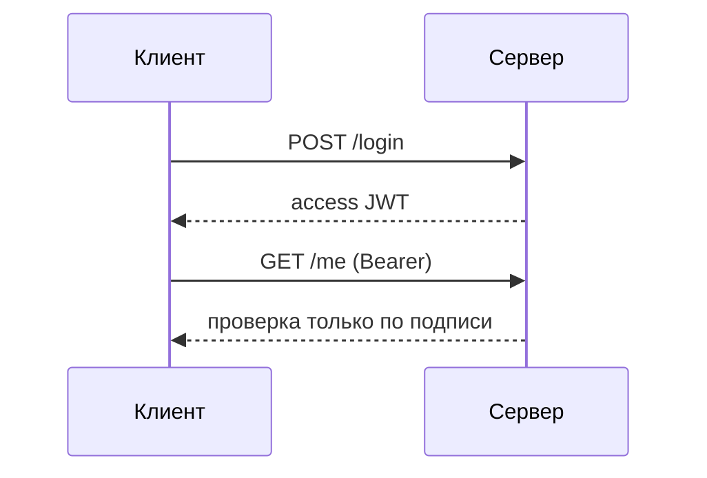
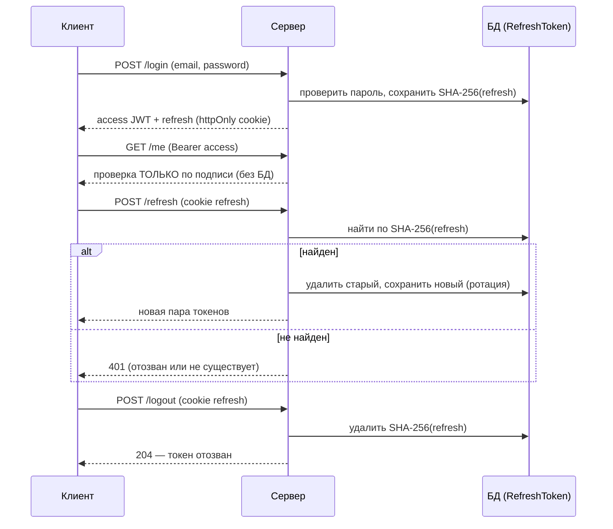

# auth-jwt

JWT-авторизация на Express + TypeScript + Prisma + PostgreSQL.

## Варианты JWT-авторизации

Существует два подхода: без сохранения состояния и с ним. В проекте реализован гибрид — stateless access-токен и stateful refresh-токен.

### 1. Stateless (без состояния)

Сервер выдаёт подписанный access-токен и ничего о нём не хранит. Проверка — только по подписи и сроку действия.

- Плюсы: нет обращения к БД, простое горизонтальное масштабирование.
- Минусы: токен нельзя отозвать до истечения, «выход» — только удаление токена на клиенте.

### 2. Stateful (с сохранением состояния)

Сервер хранит в БД хеш refresh-токена. При обновлении токен ищется по хешу — так появляются отзыв и ротация.

- Плюсы: отзыв (logout), ротация, защита от кражи токена.
- Минусы: дополнительный запрос к БД на refresh.

### Сравнение

|                      | Stateless      | Stateful            |
| -------------------- | -------------- | ------------------- |
| Сервер хранит сессию | нет            | только хеш refresh  |
| Проверка access      | только подпись | только подпись      |
| Отзыв токена         | нет            | да                  |
| Ротация токенов      | нет            | да                  |
| Нагрузка на БД       | 0              | 1 запрос на refresh |

### Что реализовано в проекте

- **Access-токен** — stateless: проверяется только по подписи, БД не участвует.
- **Refresh-токен** — stateful: в БД хранится SHA-256-хеш (`RefreshToken`), что даёт отзыв и ротацию.

## Требования

- Node.js 20+
- Docker и Docker Compose

## Запуск

1. Скопировать `.env.example` в `.env` и заполнить секреты.
2. `docker compose up -d` — поднять PostgreSQL (порт 5433) и pgAdmin (порт 5050).
3. `npm install`
4. `npx prisma migrate dev` — применить миграции.
5. `npm run dev` — сервер на `http://localhost:3000`.

## Эндпоинты

| Метод | Путь                | Описание                                                               |
| ----- | ------------------- | ---------------------------------------------------------------------- |
| POST  | `/api/auth/signup`  | Регистрация, выдача пары токенов                                       |
| POST  | `/api/auth/login`   | Вход, выдача пары токенов                                              |
| POST  | `/api/auth/refresh` | Обновление пары по refresh-токену (ротация)                            |
| POST  | `/api/auth/logout`  | Отзыв refresh-токена                                                   |
| GET   | `/api/auth/me`      | Текущий пользователь (заголовок `Authorization: Bearer <accessToken>`) |
| GET   | `/health`           | Health-check                                                           |

Refresh-токен передаётся в httpOnly-куке `refreshToken`, access-токен — в теле ответа.

## Тесты

1. Создать тестовую БД: `docker exec -it auth-postgresql createdb -U root db_jwt_test`
2. `npm run test:prepare` — применить миграции к тестовой БД.
3. `npm test`

## Переменные окружения

См. `.env.example`. Секреты (`ACCESS_TOKEN_SECRET`, `REFRESH_TOKEN_SECRET`) — минимум 16 символов.
